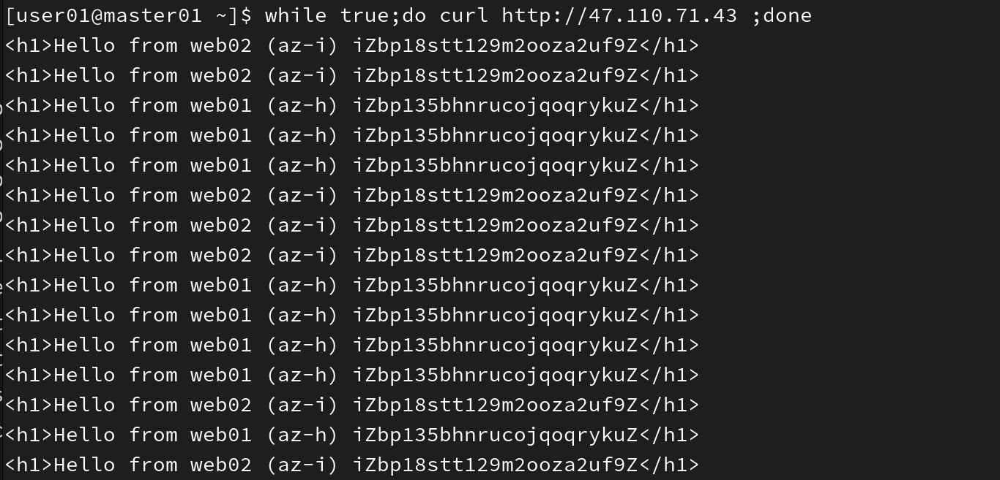
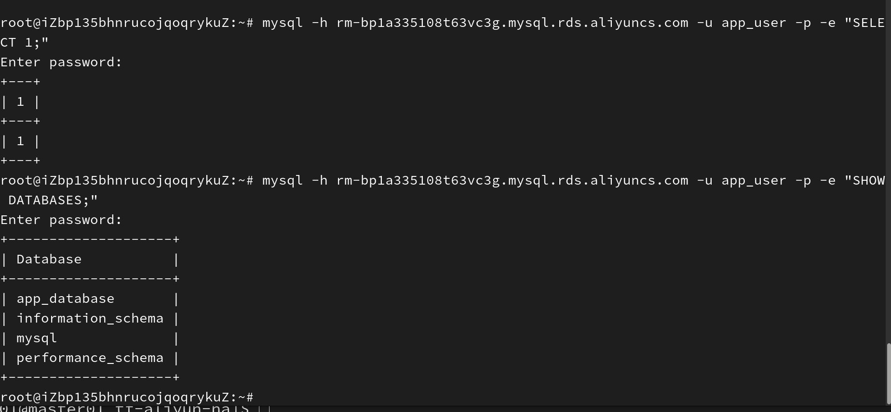
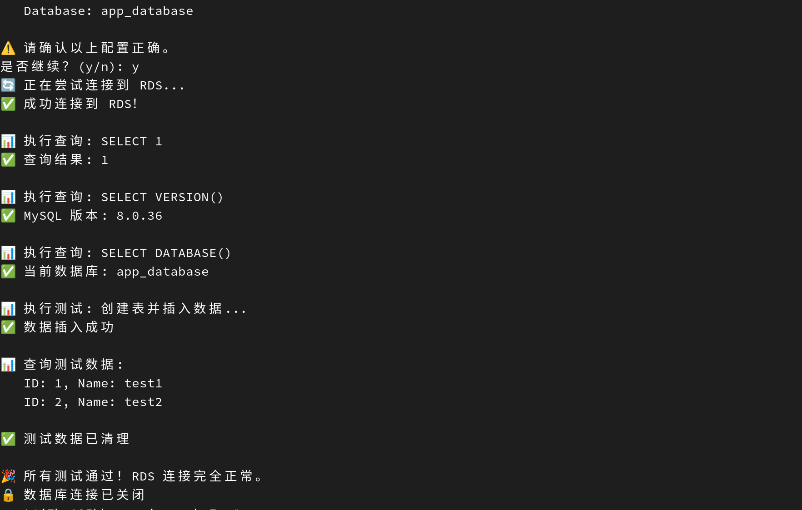
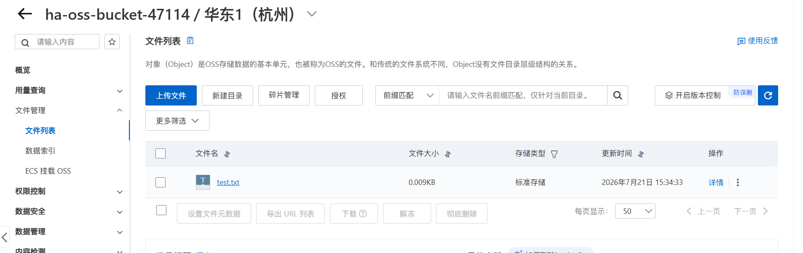
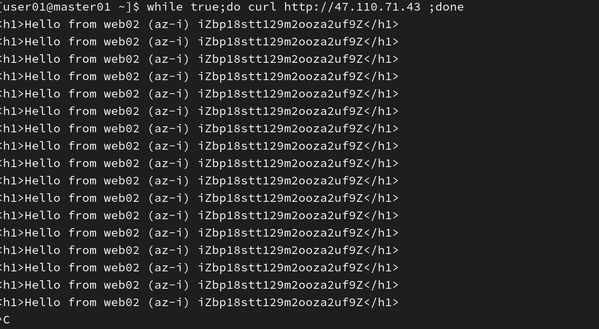

# 阿里云高可用架构 - Terraform 部署

[](LICENSE)
[](https://www.terraform.io/)
[](https://www.aliyun.com/)
[](https://github.com/beishangye/terraform-aliyun-ha/actions/workflows/terraform.yml)

用 Terraform 在阿里云一键部署一套**跨可用区 Web 架构**：VPC + 双 ECS（跨 AZ）+ 公网 SLB + RDS MySQL + OSS，完整生命周期由 IaC 管理。

> **一句话定位**：这是一套「应用层高可用」的参考实现，不是生产级高可用。
> 数据层的跨 AZ、容量弹性、可观测性都没有做，原因和差距写在 [已知局限](#已知局限) 里。
> 我更愿意把边界说清楚，而不是在架构图上画得很漂亮。

---

## 核心特性

| 能力 | 实现方式 | 真实性 |
|:---|:---|:---|
| 应用层跨可用区 | 两台 ECS 分别在 `cn-hangzhou-h` / `cn-hangzhou-i`，SLB 健康检查自动摘除故障节点 | ✅ 已实测（见 `docs/images/slb_test02.png`） |
| 负载均衡 | 公网 CLB，HTTP 80 监听，轮询分发 | ✅ 已实测 |
| 健康检查 | 专用 `/healthz` 端点，`timeout < interval` 的合理参数 | ✅ 本次修正 |
| 数据库高可用 | RDS MySQL 8.0 高可用版（同可用区主备，自动切换） | ⚠️ 仅实例级，非机房级 |
| 网络隔离 | VPC + 3 个交换机 + 安全组，RDS 白名单只放行 Web 子网 | ✅ 本次收窄 |
| 对象存储 | OSS 私有 Bucket + 服务端加密 + 强制 HTTPS | ✅ 本次补全 |
| 可复现 | 版本约束 + 提交 lock 文件 + CI 静态检查 | ✅ 本次补全 |
| 一键部署 / 销毁 | `terraform apply` / `terraform destroy` | ✅ |

---

## 高可用到哪一层（重要）

```
                        ┌──────────────────────────────────────────┐
                        │            阿里云 华东1（杭州）            │
                        │                                          │
  用户 ──► CLB (公网) ──┼──► ECS web01 (AZ-h) ──┐                   │
                        │                        │                  │
                        │  （AZ-h 故障 → 6~20s 内被健康检查摘除）      │
                        │                        │                  │
                        │      ECS web02 (AZ-i) ─┴──► RDS (AZ-i)    │
                        │                            同 AZ 主备       │
                        │                                          │
                        │                        OSS (同地域内网)    │
                        └──────────────────────────────────────────┘
```

| 层 | 是否高可用 | 说明 |
|:---|:---|:---|
| 应用层（ECS + Nginx） | ✅ 是 | 跨 AZ + 健康检查，单台故障自动摘除，容量降为 50% |
| 入口层（CLB） | ✅ 靠云产品 | CLB 是地域级、多可用区集群部署，单 AZ 故障不影响公网入口 |
| 数据层（RDS） | ⚠️ 部分 | `HighAvailability` = 同可用区主备，防机器不防机房 |
| 机房级容灾 | ❌ 无 | 单 region 单 VPC，无跨地域备份、无 GTM 切流，RTO/RPO 未定义 |
| 容量弹性 | ❌ 无 | 固定 2 台，无 ESS 弹性伸缩，单台需能临时扛 100% |
| 可观测性 | ❌ 无 | 未配 CloudMonitor 告警 / SLS，故障靠用户反馈 |

**结论**：AZ 级故障时服务会降级但不中断（前提是 RDS 不在故障 AZ）。若 RDS 所在 AZ 故障，应用整体不可用 —— 这是本架构唯一的硬单点。

---

## 部署资源清单

| 资源 | 数量 | 默认规格 | 说明 |
|:---|:---|:---|:---|
| VPC | 1 | `172.16.0.0/16` | 自定义网络 |
| 交换机 | 3 | `/24` | web1 / web2 / rds |
| ECS | 2 | `ecs.e-c1m1.large`（2C2G） | Ubuntu 22.04 + Nginx |
| CLB | 1 | `slb.s2.small` | 公网，HTTP 80 |
| RDS MySQL | 1 | 高可用版，规格显式指定 | MySQL 8.0，主备 |
| OSS | 1 | 标准存储 | 私有 + AES256 + 强制 HTTPS |
| 安全组 | 1 | — | 仅放行 22（限定来源）与 80 |

---

## 快速开始

### 前置条件

- 阿里云账号，已开通 RDS 与 OSS
- Terraform >= 1.5（本项目在 1.9.8 上验证）
- 阿里云 AccessKey（建议用 RAM 子账号，不要用主账号 AK）

### 1. 克隆

```bash
git clone https://github.com/beishangye/terraform-aliyun-ha.git
cd terraform-aliyun-ha
```

### 2. 配置变量

```bash
cp terraform.tfvars.example terraform.tfvars
```

编辑 `terraform.tfvars`，**三个必填项**：

```hcl
# 你自己的公网 IP —— 用来限制 22 端口来源
# 查法: curl -s https://ifconfig.me
my_ip = "203.0.113.10/32"

# 8-30 位，必须同时含大写、小写、数字
ecs_password = "ChangeMe2026Aa"

# 8-32 位，必须同时含大写、小写、数字
rds_account_password = "ChangeMe2026Bb"
```

> 这三个变量**没有默认值**，不填 `terraform plan` 就会报错。
> 这是刻意的：以前 `ecs_password` 默认是 `"yourpassword"`，忘了填也能 apply 成功，
> 等于用弱密码上线。现在宁可让 plan 失败，也不让弱密码溜过去。
>
> `my_ip` 还加了校验，填 `0.0.0.0/0` 会被直接拒绝。

### 3. 配置凭证

```bash
export ALICLOUD_ACCESS_KEY="LTAI..."
export ALICLOUD_SECRET_KEY="..."
```

> 凭证只走环境变量或 `aliyun configure` 生成的本地文件，**不写进任何 .tf / .tfvars / 文档**。

### 4. 初始化与预览

```bash
terraform init
terraform plan
```

`plan` 输出里如果出现 `-/+` 或 `destroy`，**停下来看清楚再继续**（尤其是 RDS 相关的）。

### 5. 部署

```bash
terraform apply
```

约 5-10 分钟。注意 apply 成功 ≠ 业务就绪，`user_data` 里的 apt 安装是异步的。

### 6. 验收

```bash
./scripts/verify-deployment.sh
```

脚本会做三件事：`/healthz` 是否 200、连续 10 次请求是否命中两台后端、后端健康状态。

### 7. 销毁

```bash
terraform destroy
```

> RDS 没有"停止"这个档位，只能释放 —— 所以销毁是唯一的不烧钱方式。
> 详见 [费用提醒](#费用提醒)。

---

## 变量说明

### 必填（无默认值）

| 变量 | 说明 |
|:---|:---|
| `my_ip` | SSH 来源 CIDR，禁止 `0.0.0.0/0` |
| `ecs_password` | ECS root 密码，8-30 位，含大小写+数字 |
| `rds_account_password` | RDS 账号密码，8-32 位，含大小写+数字 |

### 常用可选

| 变量 | 默认值 | 说明 |
|:---|:---|:---|
| `region` | `cn-hangzhou` | 地域 |
| `az_web1` / `az_web2` | `cn-hangzhou-h` / `cn-hangzhou-i` | **必须不同**，有校验 |
| `az_rds` | `cn-hangzhou-i` | RDS 可用区，显式指定 |
| `vpc_cidr` | `172.16.0.0/16` | VPC 网段 |
| `vswitch_web1_cidr` / `vswitch_web2_cidr` / `vswitch_rds_cidr` | `172.16.1.0/24` 等 | 交换机网段 |
| `ecs_type` | `ecs.e-c1m1.large` | ECS 规格 |
| `ecs_image` | Ubuntu 22.04 镜像 ID | 镜像会下线，报错时到控制台查最新 |
| `ecs_system_disk_size` | `40` | 只支持扩容 |
| `ecs_internet_bandwidth_out` | `2` | 公网出带宽（Mbps） |
| `rds_instance_class` | `mysql.n2.small.1` | 规格不可售时覆盖此项 |
| `rds_instance_storage` | `20` | 必须是 5 的倍数 |
| `rds_storage_type` | `cloud_essd` | ESSD / SSD |
| `project_name` / `environment` | `ha-demo` / `dev` | 统一标签，用于成本分摊与批量查找 |

---

## 测试验证

### 1. 负载均衡

```bash
SLB_IP=$(terraform output -raw slb_public_ip)
for i in $(seq 1 10); do curl -s http://$SLB_IP; echo; done
```

预期：`web01` 与 `web02` 交替出现。



### 2. RDS 连通性（在 ECS 上）

```bash
export RDS_HOST=$(terraform output -raw rds_connection_string)
export RDS_USER=$(terraform output -raw rds_account_name)
export RDS_PASSWORD='你的密码'
export RDS_DATABASE=$(terraform output -raw rds_database_name)

pip install pymysql
python3 docs/test_scripts/test_rds.py
```

脚本会检查连通性、版本、**连接数使用率**（超 80% 会告警）、读写往返，并自动清理测试表。




### 3. OSS

```bash
terraform output oss_bucket_name
terraform output oss_intranet_endpoint
```

到控制台确认：Bucket 为私有、已开启服务端加密、HTTP 访问会被拒绝（策略生效）。



### 4. 高可用故障模拟

```bash
# 停掉 web01 的 nginx
ssh root@$(terraform output -raw ecs_web01_public_ip) "systemctl stop nginx"

# 观察：健康检查在 6~20 秒内把 web01 摘除，流量全走 web02
for i in $(seq 1 10); do curl -s http://$SLB_IP; echo; done

# 恢复
ssh root@$(terraform output -raw ecs_web01_public_ip) "systemctl start nginx"
```



> 为什么是「6~20 秒」而不是「3×2=6 秒」：
> 连续 3 次失败，但单次失败要等 `timeout` 超时才判定，所以真实窗口是
> `3 × (interval 或 timeout)` 量级。参数配对不当（如 `timeout > interval`）
> 会让探测重叠，窗口变得不可预测。本次已把 `timeout` 调为 3s、`interval` 调为 5s。

---

## 项目结构

```
terraform-aliyun-ha/
├── README.md
├── LICENSE
├── .gitignore
├── .tflint.hcl                     # TFLint 配置
├── .github/workflows/terraform.yml # CI：fmt / validate / tflint / checkov
│
├── versions.tf                     # 版本约束 + provider 源（+ 远程 state 注释模板）
├── provider.tf                     # provider 声明（凭证走环境变量）
├── variables.tf                    # 全部变量，含校验
├── locals.tf                       # 公共标签、Web 子网列表
├── vpc_ecs_slb.tf                  # VPC / 交换机 / 安全组 / ECS / CLB
├── rds.tf                          # RDS 实例 / 库 / 账号 / 授权
├── oss.tf                          # OSS Bucket / 随机后缀 / 加密 / HTTPS 策略
├── outputs.tf
│
├── terraform.tfvars.example        # 变量示例（真实 tfvars 不入库）
├── scripts/
│   └── verify-deployment.sh        # 部署后验收
└── docs/
    ├── images/                     # 验证截图
    └── test_scripts/
        └── test_rds.py             # RDS 连通性测试（凭证读环境变量）
```

---

## 安全说明

### 凭证管理

| 做法 | 状态 |
|:---|:---|
| 密码走必填变量 + 校验，无默认值 | ✅ 已实施 |
| 示例文件用 `ChangeMe2026Aa` 之类占位符，不含真实值 | ✅ 已实施 |
| 测试脚本从环境变量读密码，不再硬编码 | ✅ 已实施 |
| `*.tfvars` 被 gitignore，`*.tfvars.example` 例外放行 | ✅ 已实施 |
| 生产改用 `random_password` + KMS 凭据管家 | ⬜ 未做（见已知局限） |

### 关于 `sensitive = true`

一个常见误解：`sensitive = true` **不防泄漏**。它只做一件事 —— 在 `plan` / `apply`
的终端输出里把值打码成 `(sensitive value)`。值本身**明文存在 tfstate 里**。

所以 state 文件本身就是敏感文件，必须：
- 不入库（已 gitignore）
- 用 OSS 私有 Bucket + 服务端加密 + 版本控制存放
- 访问权限按人收敛

### 关于 CI 里的 AccessKey

`.github/workflows/terraform.yml` 的 `plan` job 目前用 GitHub Secrets 里的长期 AK，
这是一个**降级方案**，仅在个人实验账号上可接受。它的三个问题：

1. 长期 AK 无过期，泄漏即永久有效
2. GitHub Secrets 保护的是"存储"和"传输"，不是"使用" —— 能改 workflow 的人都能读到
3. 无法审计：ActionTrail 里全是同一个 AccessKeyId，查不出谁在什么时候用了

**生产应改为 OIDC 联合身份 + STS 临时凭证**：GitHub Actions 每次运行生成带
`repo` / `ref` claim 的 OIDC token，阿里云 RAM 侧配置 OIDC 身份提供商和角色，
信任策略里把 `sub` 卡死到 `repo:beishangye/terraform-aliyun-ha:ref:refs/heads/main`，
换取有效期 ≤1 小时的 STS 凭证。这个 job 默认关闭（`ENABLE_PLAN` 变量控制），
未配置凭据时不会跑。

### 网络暴露面

- 22 端口只对 `my_ip` 开放，且变量校验拒绝 `0.0.0.0/0`
- 80 端口对 `0.0.0.0/0` 开放（SLB 转发需要）
- ~~3306 端口对整 VPC 开放~~ —— **已删除**。Web 机器上没有任何进程监听 3306，
  这条规则只增加攻击面、不提供任何能力；RDS 的访问控制由 `security_ips` 负责，
  且已从 `172.16.0.0/16` 收窄到两个 Web 子网

---

## 静态扫描结果与处置

CI 里接了 Checkov（`soft_fail`，只报告不阻断）。首轮扫出 10 条，**逐条给了结论**。

> 扫描器的价值不在于"清零"，而在于**每一条告警都有明确处置结论**。
> 全清零往往意味着为了过扫描而关掉功能；全部无视等于没接扫描。

| 规则 | 检查项 | 处置 | 理由 |
|:---|:---|:---|:---|
| CKV_ALI_35 | RDS 开启 `log_duration` | ✅ 已修 | 排障需要知道"哪条 SQL 慢" |
| CKV_ALI_36 | RDS 开启 `log_disconnections` | ✅ 已修 | 连接异常断开是排查连接泄漏的关键线索 |
| CKV_ALI_37 | RDS 开启 `log_connections` | ✅ 已修 | 追"谁在什么时候连过" |
| CKV_ALI_20 | RDS 开启 SSL | ✅ 已修 | `ssl_action = "Open"`。注意应用侧连接串也要启 SSL，否则等于没开 |
| CKV_ALI_10 | OSS 开启版本控制 | ⚠️ 已配置，扫描器仍报 | 已加 `alicloud_oss_bucket_versioning`，但该规则只识别 bucket 内联配置，**不认独立资源** → 属于扫描器误报 |
| CKV_ALI_22 | RDS 开启 TDE 透明加密 | ⬜ 不修 | TDE 需要 KMS CMK，会引入密钥管理与额外成本；实验环境仅存测试数据。**生产必须开** |
| CKV_ALI_25 | RDS SQL 审计保留 > 180 天 | ⬜ 不修 | SQL 审计按量计费，且日志存储成本高；本项目没有合规审计要求 |
| CKV_ALI_30 | RDS 自动升级小版本 | ⬜ 不修 | **有意关闭**。自动小版本升级可能在业务高峰期重启实例，生产上应该走"评估 → 窗口期 → 手动升级" |
| CKV_ALI_12 | OSS 开启访问日志 | ⬜ 不修 | 需要额外建一个日志目标 Bucket，本场景无审计需求 |
| CKV_ALI_11 | OSS 开启传输加速 | ⬜ 不修 | 只有跨境/远距离上传才有收益，且额外计费 |
| CKV_ALI_6 | OSS 使用 CMK 加密 | ⬜ 不修 | 当前用 SSE-OSS（AES256）已满足静态加密；CMK 多的是密钥轮换与审计能力，需要 KMS 成本 |

**一个真实的细节**：第一轮扫出 10 条，修完之后第二轮变成 8 条 —— 但**不是简单地少了 2 条**：

- `CKV_ALI_35/36/37` 确实消失了（参数生效）
- `CKV_ALI_20`（RDS SSL）**第一轮没报，第二轮才出现** —— 加了 `parameters` 块之后规则才匹配上
- `CKV_ALI_10` 加了版本控制仍然报 —— 规则不认识独立资源

> 这说明扫描器的结论**不能直接当 checklist 用**，必须逐条核对代码上下文。
> "告警数变少"和"风险变少"是两件事。


**CKV_ALI_30 值得单独说**：扫描器默认认为"自动升级小版本"是安全实践（打补丁更及时），
但它和"可用性优先"是有冲突的 —— 自动升级不受你控制，可能在你最不希望的时间点重启数据库。
这是个典型的**安全与稳定性的权衡**，不是简单的"对/错"。

---

## 已知局限

按严重程度排序，这些是我知道但本轮没有做的：

| # | 局限 | 后果 | 该怎么做 |
|:---|:---|:---|:---|
| 1 | **state 仍在本地** | 换电脑/硬盘坏了 = Terraform 失忆，只能靠 tag 找回资源再逐个 import | 启用 `versions.tf` 里注释掉的 OSS backend + Tablestore 锁 |
| 2 | **未分模块** | 资源平铺，加环境（dev/staging）只能复制目录 | 抽 `modules/network`、`modules/web-tier`，用根模块组合 |
| 3 | **后端 ECS 有公网 IP** | 攻击面变大、公网 IP 在停机重启后可能变化 | 去掉公网 IP，走 NAT 网关出网 + 跳板机/SSH 隧道运维 |
| 4 | **`user_data` 承担配置管理** | 改一行文案 = plan 显示 replace = 两台 ECS 重建 | 用 Packer 打自定义镜像；配置变更交给 Ansible |
| 5 | **RDS 同可用区主备** | AZ 级故障时数据库不可用，是整体硬单点 | 换集群版/三节点企业版（`multi_zone = true`），或 PolarDB 多可用区 |
| 6 | **无监控告警** | 故障靠用户反馈，不是靠告警 | CloudMonitor：CPU / 磁盘 / 连接数 / SLB 后端异常数 |
| 7 | **密码明文进 state** | 有 state 访问权 = 有密码 | `random_password` + KMS 凭据管家，state 加密 + 权限收敛 |
| 8 | **`/healthz` 是 liveness 不是 readiness** | RDS 挂了 nginx 仍返回 200，SLB 认为后端健康 | 应用侧实现 `/readyz` 探依赖，只用于告警（不用于摘除，否则 RDS 抖动会摘光所有后端） |
| 9 | **单地域** | region 级故障无解 | 跨地域备份 + GTM 切流，成本量级完全不同 |

---

## 本次重构记录

这一轮改动不是"加功能"，是把一个"能跑通的 demo" 往"可运维的工程"推了一步。
按问题严重程度排：

### 1. 可复现性（原最大缺口）

- **新增 `versions.tf`**：`required_version` + `required_providers`，之前完全没有版本约束，
  `terraform init` 每次拉当天最新版 provider
- **`.gitignore` 不再忽略 `.terraform.lock.hcl`**：官方明确建议提交 lock 文件，
  它锁定 provider 精确版本 + 各平台二进制校验和，是可复现和供应链安全的基础
- **新增 CI**：fmt / validate / tflint / checkov 四道闸，全部不需要云凭据

### 2. 消除"不可预测的删库"（原最危险设计）

原代码：

```hcl
zone_id          = data.alicloud_db_zones.rds.zones[0].id
instance_type    = data.alicloud_db_instance_classes.rds.instance_classes[0].instance_class
instance_storage = data.alicloud_db_instance_classes.rds.instance_classes[0].storage_range.min
```

`data` 源每次 `plan` 都实时求值。某个可用区 RDS 库存卖完，`zones[0]` 就会变；
上架了新规格，`instance_classes[0]` 就会变。而这三个字段在 RDS 上**全是 ForceNew** ——
**一行代码没改，`plan` 却要删库重建**，且 Terraform 的 replace 不做任何数据迁移。

现在改为显式变量（`az_rds` / `rds_instance_class` / `rds_instance_storage`）。
代价是可用区售罄时要手动改值 —— 但"手动改一个值"比"某天自动删库"好得多。

> 原则：`data` 源适合做**查询和校验**，不适合**决定资源长什么样**。
> IaC 的信任建立在"同一个 commit 永远算出同一个 plan"。

### 3. 安全基线

- 删除 3306 安全组规则（无进程监听的端口，纯攻击面）
- RDS `security_ips` 从整个 VPC 收窄到两个 Web 子网
- `my_ip` 去掉默认值 + 加校验，禁止 `0.0.0.0/0`
- `ecs_password` / `rds_account_password` 去掉默认值 `"yourpassword"`，改为必填 + 强度校验
- `docs/test_scripts/test_rds.py` 的硬编码密码改为读环境变量
- README 里的示例密码全部换成 `ChangeMe2026Xx` 占位符
- OSS 补服务端加密（AES256）+ 拒绝非 HTTPS 访问的策略

### 4. 健康检查

| 项 | 原值 | 现值 | 原因 |
|:---|:---|:---|:---|
| `health_check_uri` | `/` | `/healthz` | `/` 是业务页面，返回码随业务变（301/403 都会误判） |
| `health_check_timeout` | 5 | 3 | 必须小于 interval |
| `health_check_interval` | 2 | 5 | `timeout(5) > interval(2)` 会让探测重叠，判定窗口不可预测 |
| `unhealthy_threshold` | 3 | 3 | 保持，但配合 5s interval，窗口变稳定 |
| `healthy_threshold` | 2 | 3 | 避免抖动导致反复上下线 |
| `health_check_http_code` | 未设 | `http_2xx` | 显式声明 |

### 5. 可维护性

- `user_data` 加 `set -euo pipefail` + `DEBIAN_FRONTEND=noninteractive`
  （原脚本 apt 失败后会继续执行，最终机器 running 但 80 端口没人监听，SLB 全异常）
- `user_data` 末尾加自检循环（失败会退出非 0，但 apply 仍不会报错 —— 这是 Terraform 的边界）
- 新增 `scripts/verify-deployment.sh` 做外部验收（补上"存在性 vs 就绪性"的缺口）
- 统一标签（`Project` / `Environment` / `ManagedBy`），删除硬编码的 `"dev"` / `"ha-demo"`
- 新增 `locals.tf`，把公共标签和子网列表收敛
- 补齐 `terraform.tfvars.example`、`LICENSE`（README 引用了但仓库里没有）
- README 修正失效引用：`docs/test_rds.sh` → `docs/test_scripts/test_rds.py`
- 删除 `variables.tf` 里重复声明的 `provider` 块

---

## 费用提醒

所有资源按量付费。

| 资源 | 相对成本 | 备注 |
|:---|:---|:---|
| **RDS 高可用版** | 最贵（约为两台 ECS 之和的 3-5 倍） | 高可用版 = 主备两份资源，且没有很小的规格 |
| ECS ×2 | 中等 | 2C2G 经济型按量 |
| CLB | 较低 | 实例费 + 流量费 |
| 公网流量 | **按 GB 计费，容易忽略** | 下载/压测会让流量费反超计算费 |
| OSS | 极低 | 存储几分钱/GB/月 |

**防超支**：

- 费用与成本 → 预算管理 → 设阈值告警（几十块就够）
- 成本分析 → **按 `Project` 标签分组** —— 这是标签最实际的用途
- 加 `expire_at` 标签 + 定时任务扫描，或最土但最有效的：apply 完立刻设个两小时后的闹钟

**关于"停止"**：

- ECS 节省停机模式：不收计算费，但**云盘照收**；公网 IP 会释放，重启后 IP 可能变
- **RDS 没有停机档位，只能释放** —— 这才是"实验完必须 destroy"的真正理由

---

## 常见问题

**Q: `apply` 报 `InvalidImageId.NotFound`？**
A: 镜像会下线。到 ECS 控制台查最新的 Ubuntu 22.04 镜像 ID，覆盖 `ecs_image` 变量。

**Q: `apply` 报 `InsufficientResourceCapacity`？**
A: 该可用区 RDS 库存不足。本项目已改成显式 `az_rds`，把 `az_rds` 换一个可用区即可
（例如 `cn-hangzhou-h` → `cn-hangzhou-k`）。注意：**必须在首次 apply 前定好**，
事后改会触发实例替换。

**Q: `apply` 报 `UserDisable`（OSS）？**
A: 先在控制台开通 OSS 服务（免费开通，按量付费）。

**Q: `terraform init` 报 `checksums previously recorded` 不匹配？**
A: lock 文件里只有当前平台的哈希。补其它平台：

```bash
terraform providers lock \
  -platform=windows_amd64 -platform=linux_amd64 -platform=darwin_arm64
```

**Q: apply 成功但访问 SLB 是 502？**
A: 大概率是 `user_data` 没跑完或 apt 失败。按这个顺序查：

```bash
ss -lntp | grep :80          # 有没有监听（看是 0.0.0.0:80 还是 127.0.0.1:80）
curl -s -o /dev/null -w '%{http_code}\n' http://127.0.0.1/healthz
cloud-init status --long     # 看 user_data 是否失败
tail -50 /var/log/cloud-init-output.log
```

---

## 贡献

欢迎 Issue / PR。提交前请确保本地通过：

```bash
terraform fmt -check -recursive
terraform init -backend=false && terraform validate
```

## 许可证

MIT，详见 [LICENSE](LICENSE)。

## 致谢

- [Terraform 阿里云 Provider](https://registry.terraform.io/providers/aliyun/alicloud/latest)
- [阿里云官方文档](https://help.aliyun.com/)
