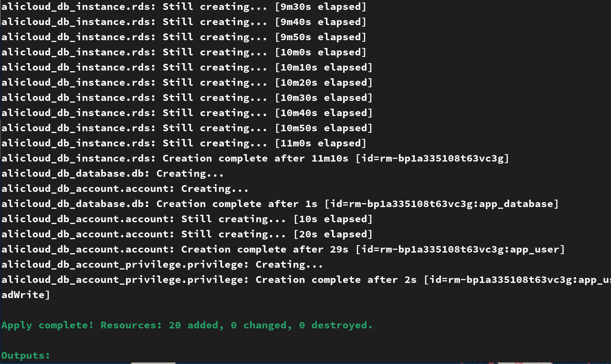
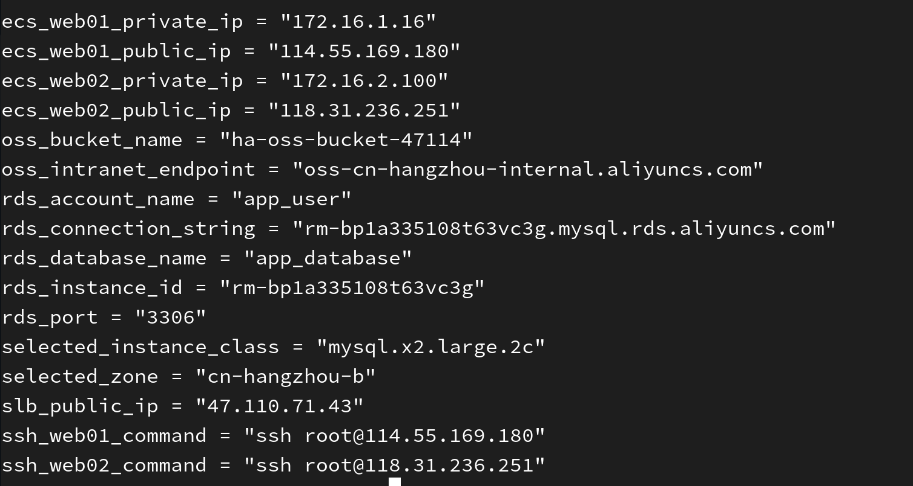

```markdown
# 阿里云高可用架构 - Terraform 部署

[](LICENSE)
[](https://www.terraform.io/)
[](https://www.aliyun.com/)

## 📖 项目简介

本项目使用 Terraform 在阿里云上一键部署一套**高可用 Web 应用架构**，适合作为云架构实验、开发测试环境或生产环境的参考模板。

### 🎯 核心特性

- ✅ **跨可用区高可用**：两台 ECS 实例分别部署在不同可用区（默认 `cn-hangzhou-h` 和 `cn-hangzhou-i`）
- ✅ **负载均衡**：公网 SLB 自动分发流量，健康检查保障服务连续性
- ✅ **数据库高可用**：RDS MySQL 高可用版，主备节点自动故障切换
- ✅ **对象存储**：OSS 存储桶，用于存放静态文件或备份
- ✅ **网络隔离**：VPC 专有网络，精细化安全组控制
- ✅ **一键部署/销毁**：Terraform 管理完整生命周期
- ✅ **自动选择可用区**：RDS 自动选择有库存的可用区，避免手动试错

### 🏗️ 架构图

```
                         ┌─────────────────────────────────────┐
                         │           阿里云 华东1（杭州）        │
                         │                                      │
   用户 ───► SLB (公网) ─┼──► ECS Web01 (可用区 H) ───┐       │
                         │         │                   │       │
                         │         ▼                   ▼       │
                         │    ┌─────────────────────────────┐  │
                         │    │     RDS MySQL 高可用版       │  │
                         │    │   (自动选择有库存的可用区)   │  │
                         │    └─────────────────────────────┘  │
                         │         │                   │       │
                         │         ▼                   ▼       │
                         │    OSS 对象存储 (静态文件/备份)     │
                         │                                      │
                         └─────────────────────────────────────┘
```

### 📦 部署资源清单

| 资源类型 | 数量 | 规格 | 说明 |
|:---|:---|:---|:---|
| VPC 专有网络 | 1 | 172.16.0.0/16 | 自定义网络隔离环境 |
| VSwitch 交换机 | 3 | /24 网段 | Web01、Web02、RDS 各一个 |
| ECS 实例 | 2 | ecs.e-c1m1.large (2核2G) | Ubuntu 22.04，预装 Nginx |
| SLB 负载均衡 | 1 | slb.s2.small | 公网型，HTTP 监听 |
| RDS MySQL | 1 | 高可用版，规格自动选择 | MySQL 8.0，主备架构 |
| OSS 存储桶 | 1 | 标准型 | 私有读写，自动生成唯一名称 |
| 安全组 | 1 | - | 精细化端口控制 |

---

## 🚀 快速开始

### 前置条件

- ✅ 阿里云账号（已开通 RDS 和 OSS 服务）
- ✅ Terraform >= 1.5（[安装指南](https://learn.hashicorp.com/tutorials/terraform/install-cli)）
- ✅ 阿里云 AccessKey 和 SecretKey（[获取指南](https://help.aliyun.com/document_detail/53045.html)）
- ✅ （可选）Git 命令行工具

### 部署步骤

#### 1. 克隆项目

```bash
git clone https://github.com/您的用户名/terraform-aliyun-ha.git
cd terraform-aliyun-ha
```

#### 2. 配置变量

```bash
# 复制示例变量文件
cp terraform.tfvars.example terraform.tfvars

# 编辑变量文件，填入您的配置
vim terraform.tfvars
```

**必填变量**（至少需要设置以下两个密码）：

```hcl
# terraform.tfvars
ecs_password          = "YourECS@Password123"      # 请修改为强密码
rds_account_password  = "YourRDS@Password123"      # 请修改为强密码
my_ip                 = "113.xx.xx.xx/32"          # 建议改为您的公网IP
```

#### 3. 设置阿里云凭证

通过环境变量配置 AccessKey：

```bash
export ALICLOUD_ACCESS_KEY="LTAIxxxxxxxxxxxx"
export ALICLOUD_SECRET_KEY="xxxxxxxxxxxxxxxxxxxx"
```

> 💡 也可以使用 `aliyun configure` 命令配置 CLI 凭证，Terraform 会自动读取。

#### 4. 初始化 Terraform

```bash
terraform init
```

#### 5. 查看执行计划

```bash
terraform plan
```

检查输出中是否有意外资源变更，确认无误后继续。

#### 6. 部署资源

```bash
terraform apply
```

输入 `yes` 确认。整个部署过程约需 **5-10 分钟**。

#### 7. 验证部署结果


```bash
# 查看所有输出
terraform output

# 获取 SLB 公网 IP
terraform output slb_public_ip

# 浏览器访问 http://<SLB_IP>，刷新查看负载均衡效果
```

#### 8. 销毁资源（实验完成后）

```bash
terraform destroy
```

输入 `yes` 确认，所有资源将被删除。

---

## ⚙️ 变量说明

### 必需变量（无默认值，必须填写）

| 变量名 | 说明 | 示例 |
|:---|:---|:---|
| `ecs_password` | ECS 实例 SSH 密码（8-30位，需包含大小写字母和数字） | `MyP@ssw0rd123` |
| `rds_account_password` | RDS 数据库账号密码（8-32位，需包含大小写字母和数字） | `RDS@Passw0rd2026` |

### 可选变量（有默认值，可按需修改）

| 变量名 | 说明 | 默认值 |
|:---|:---|:---|
| `az_web1` | Web01 部署可用区 | `cn-hangzhou-h` |
| `az_web2` | Web02 部署可用区 | `cn-hangzhou-i` |
| `vpc_cidr` | VPC 网段 | `172.16.0.0/16` |
| `vswitch_web1_cidr` | Web01 交换机网段 | `172.16.1.0/24` |
| `vswitch_web2_cidr` | Web02 交换机网段 | `172.16.2.0/24` |
| `vswitch_rds_cidr` | RDS 交换机网段 | `172.16.3.0/24` |
| `ecs_type` | ECS 实例规格 | `ecs.e-c1m1.large` |
| `ecs_image` | ECS 镜像 ID | `ubuntu_22_04_x64_20G_alibase_20260615.vhd` |
| `my_ip` | 允许 SSH 访问的 IP（CIDR 格式） | `0.0.0.0/0` ⚠️ 建议修改 |
| `rds_name` | RDS 实例名称 | `ha-mysql` |
| `rds_db_name` | RDS 数据库名称 | `app_database` |
| `rds_account_name` | RDS 数据库账号 | `app_user` |

---

## 🧪 测试验证

### 1. 验证负载均衡

```bash
# 获取 SLB IP
SLB_IP=$(terraform output -raw slb_public_ip)

# 连续访问，查看响应主机名变化
for i in {1..10}; do curl -s http://$SLB_IP; echo ""; done
```

预期结果：`web01` 和 `web02` 交替出现。

### 2. 验证 RDS 连接（在 ECS 上执行）

```bash
# 登录到 Web01
ssh root@$(terraform output -raw ecs_web01_public_ip)

# 安装 MySQL 客户端
apt-get update && apt-get install -y mysql-client

# 连接 RDS
mysql -h $(terraform output -raw rds_connection_string) -u app_user -p
# 输入密码：YourRDS@Password123

# 执行测试查询
SELECT VERSION();
SHOW DATABASES;
USE app_database;
CREATE TABLE test(id INT);
INSERT INTO test VALUES(1);
SELECT * FROM test;
DROP TABLE test;
EXIT;
```


### 3. 验证 OSS

```bash
# 获取 Bucket 名称
terraform output oss_bucket_name

# 登录阿里云 OSS 控制台，查看 Bucket 是否已创建
# 或使用 ossutil 工具（需单独安装）
```

### 4. 高可用故障模拟

```bash
# 模拟 web01 故障
ssh root@$(terraform output -raw ecs_web01_public_ip) "systemctl stop nginx"

# 连续访问 SLB，观察流量是否自动切换到 web02
for i in {1..10}; do curl -s http://$SLB_IP; echo ""; done


# 恢复 web01
ssh root@$(terraform output -raw ecs_web01_public_ip) "systemctl start nginx"
```

---

## 📁 项目结构

```
terraform-aliyun-ha/
├── README.md                       # 项目文档
├── LICENSE                         # 许可证文件
├── .gitignore                      # Git 忽略规则
│
├── provider.tf                     # Provider 和版本配置
├── variables.tf                    # 变量定义
├── outputs.tf                      # 输出定义
├── vpc_ecs_slb.tf                  # VPC、ECS、SLB 资源配置
├── rds.tf                          # RDS MySQL 配置（含 data 数据源）
├── oss.tf                          # OSS 存储配置（含 random）
│
├── terraform.tfvars.example        # 变量示例文件（不含敏感信息）
│
└── docs/
    └── test_rds.sh                 # RDS 一键测试脚本
    └──images
```

---

## ⚠️ 注意事项

### 费用提醒

- **所有资源均为按量付费**，请合理控制使用时间
- 实验完成后**务必执行 `terraform destroy`** 清理资源，避免持续扣费
- 预估费用（运行 2 小时）：约 **1.5 ~ 2.2 元**（仅供参考，以实际账单为准）

### 安全提醒

- **不要将 `terraform.tfvars` 提交到版本控制**
- **建议修改 `my_ip` 变量**为您的公网 IP（如 `113.xx.xx.xx/32`），避免 SSH 全网开放
- 生产环境请使用更复杂的密码和更严格的访问控制

### 常见问题

**Q: RDS 创建失败，提示 `InsufficientResourceCapacity`？**

A: 这是可用区库存不足。`rds.tf` 已配置 `data` 数据源自动查询有库存的可用区，如仍失败可尝试修改 `az_web1` 和 `az_web2` 为其他可用区。

**Q: OSS 创建失败，提示 `UserDisable`？**

A: 请先登录阿里云控制台，开通 OSS 服务（免费开通，按量付费）。

**Q: 镜像 ID 失效怎么办？**

A: 登录阿里云 ECS 控制台，查询最新的 Ubuntu 22.04 镜像 ID，替换 `ecs_image` 变量。

---

## 🤝 贡献

欢迎提交 Issue 和 Pull Request！

1. Fork 本仓库
2. 创建您的特性分支 (`git checkout -b feature/amazing-feature`)
3. 提交您的更改 (`git commit -m 'Add some amazing feature'`)
4. 推送到分支 (`git push origin feature/amazing-feature`)
5. 打开一个 Pull Request

---

## 📄 许可证

本项目采用 MIT 许可证。详见 [LICENSE](LICENSE) 文件。

---

## 🙏 致谢

- [Terraform 阿里云 Provider](https://registry.terraform.io/providers/aliyun/alicloud/latest)
- [阿里云官方文档](https://help.aliyun.com/)
```

---

## 📝 使用说明

1. 将上述内容保存为 `README.md`，放在项目根目录
2. 将 `https://github.com/您的用户名/terraform-aliyun-ha.git` 替换为您的实际仓库地址
3. 根据需要调整架构图（可使用 [Mermaid](https://mermaid.js.org/) 或 [Draw.io](https://draw.io) 等工具生成更精美的图表）
4. 如果不需要某些章节，可以删除或简化

这份 README 涵盖了项目介绍、快速开始、变量说明、测试验证、常见问题等完整内容。